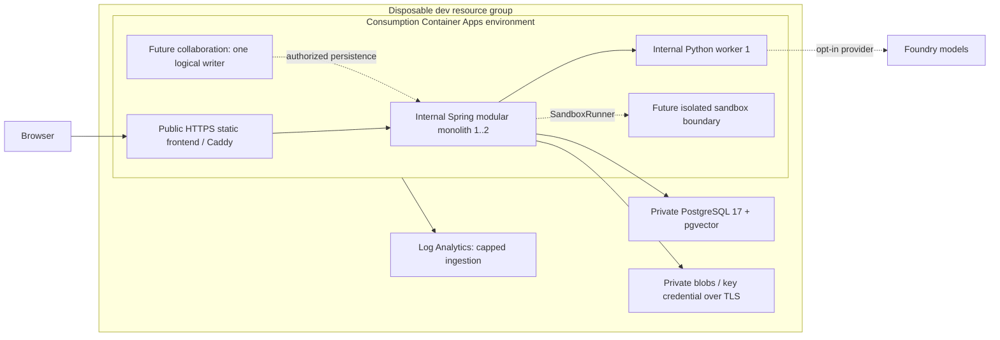

# ADR-010: Demo, ephemeral Azure validation and production reference

- Status: Accepted
- Date: 2026-10-12
- Backlog: RH-200 (Task 21.1), RH-350
- Dependencies: Task 11.3 (AI evaluation) and Task 15.7 (analysis reproduction); [evaluation](../evaluation/README.md) and [reproduction](../development/analysis-execution.md) inform the validation window, not a cloud-proof claim.
- Implementation trigger: use the local demo now; provision Azure dev/staging only for a scheduled, funded validation window. A production deployment requires the evidence and operational gates below.

## Decision and current evidence

Keep Spring Boot 4.1.1 / Java 25 / Maven as a modular monolith. Use the Boot BOM for managed dependencies.
React/TypeScript remains Webpack/Babel with npm lockfiles. Python AI/data and scientific execution stay
outside Java domain logic. PostgreSQL owns sessions, quotas, provenance and durable dispatch; Flyway
creates schema and Hibernate only validates it. Every workspace-owned operation is authorized by Spring.

Accepted describes the topology policy, **not a successful Azure deployment**. The Azure profile and
connection-string Blob adapter already have local Testcontainers tests; managed identity for Blob is
not implemented. [IaC](../../infrastructure/README.md) supports disposable `dev` infrastructure and an
optional application deployment. Compilation and offline tests do not establish Azure runtime behavior.

| Environment | Topology and use | What it proves | What it does not prove |
| --- | --- | --- | --- |
| Cost-optimized demo | Laptop Compose, Caddy, PostgreSQL/pgvector, Azurite, worker, one collaboration writer; explicit local Docker sandbox | Recorded local product flows; two Spring replicas with shared sessions and quotas in the [local report](../../performance/results/2026-10-08-local-two-instance/README.md) | Azure compatibility, managed-service failover, production capacity, distributed room writers or public-host sandbox safety |
| Ephemeral Azure staging | Disposable `dev` IaC is the first validation fixture; managed PostgreSQL/Blob and Consumption Container Apps; backend/worker internal, static frontend edge public; collaboration and sandbox disabled | After an actual run: provider provisioning, migrations, TLS, ingress, adapters and cloud smoke checks for the deployed image digests | No cloud result exists yet. Staging cannot establish production HA, an SLA, realtime scale-out, cloud execution or real-model quality with deterministic providers |
| Azure production reference | Design: public HTTPS static edge, Spring 2..N, worker initially warm (0..N only after cold-start validation), single logical collaboration writer, managed PostgreSQL/Blob | An explicit target and migration boundaries | No production manifest, HA rollout, backup recovery, alerting, erasure, distributed collaboration or sandbox adapter is delivered by this decision |

The `dev` environment is disposable, not an alias for production. A staging configuration and evidence
must be added before claiming a staging release. Registering users is disabled by default. The optional
dev frontend serves same-origin `/api`; it does not expose Spring `/internal/**`. Collaboration is not
wired into the Azure dev edge. Deterministic worker responses must be identified as fixtures, not live AI.

RH-329/RH-330/RH-343/RH-344 now add a separate
[staging configuration and lifecycle/monitoring runbook](../deployment/azure-staging.md). It reuses the
dev foundation, adds the explicitly requested ACR/Application Insights/dashboard/alerts/budget and keeps
collaboration/sandbox disabled. Cloud deployment and telemetry evidence are still pending; the dev-only
resource classification below is not a claim that staging omits those operational resources.

## Resource diagram

Solid arrows are the optional dev application path; dotted arrows are future reference capabilities.
The foundation exists as code even when `deployApplications=false`.

"Private blobs" means anonymous access is disabled; the dev storage service endpoint is public,
authenticated and HTTPS-only. No storage private endpoint or outbound network isolation is claimed.
The VNet also causes Azure-managed networking resources and charges outside the named resource group.

## Cost classification (RH-200)

Classes describe the intended lifecycle while a validation window is open. "Required continuously"
does not mean a permanent paid student deployment. Exact prices, regional availability and remaining
credit must be checked in the subscription before provisioning; no fixed free-tier or monthly-price promise.

| Candidate resource | Classification | Decision and credit control |
| --- | --- | --- |
| Resource Group | Required continuously (container for window) | Stable per owner/environment; tags project/environment/owner/studentContext/expiresAt; deletion ends the window |
| Container Apps Environment | Required continuously; associated infrastructure can consume credit | Consumption workload profile only; no Dedicated profile, NAT Gateway or Firewall; include managed IP/load-balancer costs |
| Spring backend Container App | Required continuously during window | Minimum 1 for current scheduled PostgreSQL dispatcher; maximum 1 by default; scale-out needs connection budget incl. rollout |
| Python worker Container App | Required continuously during current validation; scale-to-zero/on-demand candidate | Minimum/maximum 1 now. Prove cold-start fits caller deadlines before setting zero; no model secrets in Spring |
| Collaboration service | Required continuously when realtime is enabled | Not provisioned in dev. One logical writer, never uncontrolled replica autoscale; [ADR-013](ADR-013-collaboration-scale-out.md) |
| Container Apps Jobs / Dynamic Sessions sandbox | Scale-to-zero/on-demand candidate; expensive/risk of consuming student credit | Not provisioned. Sessions billing/pool capacity and isolation must be evaluated; [ADR-015](ADR-015-azure-sandbox-runner.md) |
| Azure Database for PostgreSQL | Required continuously; expensive/risk of consuming student credit | B1ms, 32 GiB, no HA or geo backup in disposable dev; 7-day backup. Compute/storage/backups billed independently; delete after window |
| Blob Storage | Required continuously for retained bytes | Standard LRS Hot, no anonymous access; synthetic inputs only. No general age-based deletion of immutable versions before [ADR-014](ADR-014-retention-and-erasure.md) |
| Azure AI Search | Optional for demo only; expensive/risk of consuming student credit | Omitted: pgvector is the agreed engine; a second index requires measured need and a new decision |
| Microsoft Foundry model deployments | Scale-to-zero/on-demand for metered calls; expensive/risk of consuming student credit | Omitted: deterministic dev worker. Explicit token/rate caps and quality evaluation before enabling a metered model; no provisioned throughput |
| Document Intelligence | Optional for demo only; on-demand calls can consume credit | Omitted until scanned-PDF OCR becomes a measured requirement; local parsers remain the implementation |
| Service Bus | Optional for demo only; standing tier and usage can consume credit | Omitted: [ADR-011](ADR-011-durable-processing-in-postgresql.md) keeps durable PostgreSQL dispatch until measured pressure justifies a broker |
| Application Insights / Log Analytics | Log Analytics required for current dev diagnostics; Application Insights optional for demo only | Only Log Analytics provisioned; 30-day retention and 0.1 GiB/day ingestion cap. Cap can delay diagnostics and is not a hard financial stop |
| Key Vault | Required continuously in a future production secrets design; optional for current demo | Omitted from dev: secure ARM parameters and Container Apps secret references use the already supported key adapter. Key Vault/identity rotation is a follow-up, not a delivered capability |

Use an 8-hour window (maximum 24 hours in the wrapper), budget alerts at 50/80/100% of an agreed
window allocation, bounded replicas/requests, synthetic data and explicit teardown. A budget alert and
an `expiresAt` tag **do not stop spending or delete resources**. Do not treat a stopped database as
free storage or permanent teardown. Preserve redacted evidence, then delete the fixture resource group;
verify the managed environment's auxiliary resources have gone too.

## Promotion triggers and limits

Before a cloud claim, retain image digests, IaC revision, provider versions, sanitized deployment outputs,
Flyway validation, health, upload/retrieval, server workspace denial and cross-replica session/quota evidence.
No credentials or real research content in evidence. Before production additionally prove backup restore,
operational alerts, least-privilege credentials/rotation, rollout capacity, and actual retention/erasure.
Realtime and sandbox remain gated independently. No microservices split, Redis, Service Bus, Search or
general-purpose cluster is introduced to make the diagram appear complete.

Sources checked 2026-10-12: [Container Apps billing](https://learn.microsoft.com/en-us/azure/container-apps/billing),
[VNet managed resources](https://learn.microsoft.com/en-us/azure/container-apps/custom-virtual-networks),
[budgets](https://learn.microsoft.com/en-us/azure/cost-management-billing/costs/tutorial-acm-create-budgets).
IaC choice and commands: [ADR-017](ADR-017-azure-infrastructure-as-code.md), [Azure runbook](../../infrastructure/README.md).
