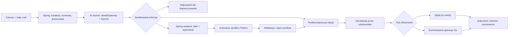

# Canvas AI — analiza architektury i backlog techniczny

Data analizy: **2026-10-09**. Stan wdrożenia z **2026-10-11**: **CAI-01–15 zaimplementowane**;
CAI-16–18 pozostają propozycją. Zakres działający opisuje [canvas-ai.md](canvas-ai.md),
a wyniki i polecenia weryfikacji — [CAI-10–12](canvas-scientific-validation.md) i [CAI-13–15](canvas-packages-validation.md).
Identyfikatory `CAI-01`–`CAI-18` są lokalnymi identyfikatorami tego backlogu. Numery `RH-*`
i `Task N.M` należy przydzielić przy przenoszeniu zadań do właściwego epiku.

## Rekomendacja

Rozbudować obecny edytor Tiptap/ProseMirror o menu kontekstowe i mały czat przy kursorze.
Czat ma używać istniejącej historii rozmów workspace, a zmiany dokumentu — trwałych propozycji
z akceptacją. Analizy i obliczenia mają korzystać z obecnego modułu `analysis` oraz izolowanego
sandboxa Python. Natywny adapter Gemini pozostaje adapterem modelu; jego zadaniem jest
interpretacja polecenia, planowanie i opis, a wartości liczbowe pochodzą z wykonania obliczeń.

Największe rozszerzenia to **akceptowanie zmian AI w Yjs**, **rozwiązywanie zadania bez pliku CSV/XLSX**
oraz **strukturalne wzory i sprawdzane kroki obliczeń**. Samo dodanie okienka czatu nie zapewni tego przepływu.

## Co już istnieje i co trzeba uzupełnić

| Obszar | Stan potwierdzony w projekcie | Potrzebna zmiana |
| --- | --- | --- |
| Canvas | Tiptap, selekcja, identyfikatory bloków, toolbar, komentarze i cytowania | Obsługa prawego przycisku i kontekstowego celu edycji, także pustego kursora |
| Czat | Trwałe rozmowy i wiadomości workspace, idempotentne wysyłanie, autoryzacja, SSE | Pochodzenie z dokumentu, małe okno, typowane rezultaty i kontynuacja kontekstu |
| Pamięć rozmowy | `ConversationService.send()` przekazuje bieżące pytanie do `WorkspaceQuestionService`; historia nie jest pamięcią modelu | Ograniczony kontekst poprzednich tur i jednoznaczne odniesienia do propozycji/wyników |
| Edycja AI | `DRAFT`, `REWRITE`, `EVIDENCE`; podgląd i akceptacja sprawdzająca rewizję | Wstawianie w środku akapitu, pakiety bloków i powiązanie z wiadomością czatu |
| Współpraca | Yjs jest kanonicznym stanem aktywowanego dokumentu; dawny PATCH i akceptacja AI po rewizji zwracają konflikt | Serwerowa ścieżka zastosowania propozycji do kanonicznego Yjs |
| Analizy | Planowanie, trwały dispatcher, sandbox, wyniki `TABLE`/`CHART`/`TEXT`, historia i provenance | Uruchamianie z czatu oraz nowy rodzaj wejścia `PROBLEM` |
| Wejścia obliczeń | `AnalysisContracts.Create` i manifest sandboxa wymagają co najmniej jednego CSV/XLSX | Niemutowalny zapis treści zadania, parametrów, jednostek i założeń |
| Wzory | Brak węzłów matematycznych w schemacie edytora i collaboration; `Report.Equation` to zarezerwowany typ eksportu | Wspólny kontrakt wzorów, bezpieczne renderowanie, zapis i eksport |
| Wstawianie wyników | `analysisResult` wskazuje konkretny analysis/execution/output; nie podmienia wyniku na najnowszy | Pakiet rozwiązania: dane → wzór → podstawienie → kroki → wynik → opcjonalny wykres |
| Gemini | Natywny provider i embeddings, walidacja schematu, ograniczona naprawa i telemetry | Nowe wersje promptów i kontraktów; bez kolejnego klucza API |

Podstawy w kodzie:

- [DocumentBodyEditor](../../frontend/src/features/documents/components/DocumentBodyEditor.tsx),
  [DocumentEditorForm](../../frontend/src/features/documents/components/DocumentEditorForm.tsx),
  [blockIdentity](../../frontend/src/features/documents/provenance/blockIdentity.ts).
- [ResearchPanel](../../frontend/src/features/ai/components/ResearchPanel.tsx),
  [ConversationService](../../backend/src/main/java/dev/researchhub/ai/application/ConversationService.java),
  [ConversationContracts](../../backend/src/main/java/dev/researchhub/ai/application/ConversationContracts.java).
- [AnalysisContracts](../../backend/src/main/java/dev/researchhub/analysis/application/AnalysisContracts.java),
  [protokół sandboxa](../../sandbox/runtime/protocol.py),
  [schemat collaboration](../../collaboration/src/schema.ts).
- [EditorReportAdapter](../../backend/src/main/java/dev/researchhub/export/application/EditorReportAdapter.java),
  [Report](../../backend/src/main/java/dev/researchhub/export/domain/Report.java).

## Zgodność z design-reference

[DESIGN_SPEC](../../design-reference/DESIGN_SPEC.md), §2 i §3.2, przewiduje kontekstowe AI,
menu i popovery, bez stałej kolumny czatu. Użyć istniejących tokenów i warstw overlay:
menu około 170–190 px, wiersze 32 px, cień e2; czat jako większy popover o responsywnej szerokości.
Obecne [prymitywy overlay](../../frontend/src/shared/components/overlays/Popover.tsx) wymagają
rozszerzenia o kotwicę wirtualną opartą na współrzędnych/kursorze.

[Document_editor.pdf](../../design-reference/Document_editor.pdf), strona 2, pokazuje
`Accept / Reject / Edit`; strona 3 — propozycję przed wstawieniem.
[Analysis_studio.pdf](../../design-reference/Analysis_studio.pdf), strony 2–4, opisuje plan,
izolowane wykonanie, wyniki i czytelny błąd.
[Results,provenance&insert.pdf](<../../design-reference/Results,provenance&insert.pdf>) oraz
[Key_user_flows.pdf](../../design-reference/Key_user_flows.pdf) wymagają zachowania historii wykonania
i świadomego wstawienia wyniku. Mały czat przy prawym przycisku oraz rozwiązania zadań bez datasetu
są rozszerzeniem tych wzorców; nie są gotowym ekranem obecnej specyfikacji.

Przyjęta decyzja UX: AI przygotowuje podgląd, a użytkownik wybiera **Wstaw** albo **Zastąp zaznaczenie**.
Polecenie „oblicz” upoważnia do uruchomienia poprawnie zwalidowanego planu w granicach limitów;
dodatkowe pytanie jest potrzebne przy brakujących danych, niejednoznacznym celu lub nowym zakresie danych.
Dokument zmienia się po akceptacji. To zachowuje istniejącą zasadę kontroli nad treścią.

## Docelowy przepływ użytkownika

1. Prawy przycisk w canvasie otwiera menu: Cofnij, Ponów, Wytnij, Kopiuj, Wklej,
   Usuń zaznaczenie, podstawowe formatowanie oraz **Ask AI**. Akcje zależą od zaznaczenia i roli.
2. Kliknięcie wewnątrz zaznaczenia zachowuje jego zakres. Kliknięcie poza nim ustawia nowy cel przy kursorze.
   Kliknięcie wyniku analizy wybiera ten wynik jako kontekst. Menu nie przechwytuje pól formularzy poza canvasem.
3. Ask AI otwiera mały czat przy miejscu kliknięcia. Nagłówek pokazuje dokument, cel, zakres źródeł
   i informację, że rozmowa będzie widoczna w historii workspace. Na wąskim ekranie używa slide-over.
4. Pierwsze wysłanie tworzy osobną trwałą rozmowę. Otwarcie i zamknięcie pustego okna nie zaśmieca historii.
   Kolejne wiadomości trafiają do tej samej rozmowy. Nowe wywołanie Ask AI rozpoczyna nową rozmowę;
   wznowienie z historii otwiera poprzednią.
5. „Dodaj więcej treści” tworzy propozycję przy przypiętym celu. „Rozwiń tę propozycję” odnosi się do
   poprzedniej propozycji; „rozwiń wstawiony fragment” — do bloków ostatniej zaakceptowanej operacji.
   Nowe miejsce kursora nie przestawia celu istniejącej rozmowy bez wybrania **Zmień kontekst**.
6. „Oblicz zadanie” zapisuje wejście, planuje i uruchamia sandbox. „Zrób wykres z measurements.xlsx”
   korzysta z wybranej wersji datasetu. Postęp i odnośnik do analizy są widoczne w czacie.
7. Gotowy pakiet pokazuje wzory, podstawienia, jednostki, wyniki, założenia i wykres/tabelę.
   Jedna akceptacja wstawia cały wybrany pakiet, zachowując provenance i historię czatu.
8. Zamknięcie okna nie usuwa rozmowy ani nie anuluje automatycznie zadania. Po odświeżeniu lub restarcie
   użytkownik odnajduje stan i wynik w historii. **Anuluj** jest osobną, jawną akcją.

Viewer ma Kopiuj, zaznaczanie, Ask AI do pytań i objaśnień oraz odczyt zapisanych wyników.
Wycinanie, edycja, uruchamianie analiz i wstawianie są dostępne owner/editor w aktywnym workspace.
Backend sprawdza uprawnienia także wtedy, gdy ktoś ręcznie wywoła ukryte polecenie.

## Architektura i granice odpowiedzialności

Spring pozostaje modularnym monolitem. `ai`, `document`, `analysis`, `collaboration` i `export`
komunikują się przez granice application, bez bezpośredniego dostępu do cudzych repozytoriów.
AI worker nie otrzymuje dostępu do bazy ani sesji użytkownika. Gemini nie wykonuje kodu ani operacji
na dokumencie. Router zwraca typowany plan z dozwolonej listy, a serwer wybiera konkretne istniejące usługi.

Nie potrzeba nowego providera, bazy wektorowej, brokera, mikroserwisu agentowego ani zewnętrznego CAS.
Trwałe etapy pracy wykorzystują PostgreSQL i istniejący wzorzec dispatcherów. Obliczenia działają
w dotychczasowej granicy [ADR-008](../adr/ADR-008-analysis-execution-boundary.md).

### Cel edycji i zmiany współbieżne

Rozdzielić ekranową kotwicę popovera od logicznego celu. Piksele i `from/to` nie wystarczają:
po zmianie przez drugą osobę mogłyby wskazywać inny tekst. Wykorzystać stabilne `blockId`,
offsety UTF-16 w potwierdzonym fragmencie, hash treści, rewizję materializacji i epoch pokoju.
W Yjs utrzymywać pozycje względne związane z kanonicznym stanem. Dokumentacja opisuje ich zachowanie
przy zmianach zdalnych i możliwość utraty celu po usunięciu typu: [Y.RelativePosition](https://docs.yjs.dev/api/relative-positions).

Spring zwraca `contextId` po weryfikacji dokumentu i zakresu. Pozycja względna otrzymana z przeglądarki
jest niezaufana; collaboration musi rozwiązać ją w właściwym pokoju i potwierdzić typ, blok i treść.
Zmiana poza celem może pozwolić na ponowne zakotwiczenie. Zmiana zaznaczonego tekstu, usunięcie bloku
lub zmiana epoch wymaga odświeżenia celu. Brak dopasowania nie oznacza wstawienia na końcu dokumentu.

Przed przechwyceniem kontekstu: legacy czeka na poprawny autosave; realtime czeka na potwierdzenie
trwałego snapshotu. Niezapisana lub offline treść nie jest wysyłana jako rzekomo zapisany dokument.
Zwykłe lokalne pisanie nadal działa; polecenie AI pozostaje w formularzu do ponowienia po synchronizacji.

### Kontekst rozmowy i zaufanie

Do modelu trafia wybrany fragment, ograniczone otoczenie, wskazane źródła/wyniki i ograniczona historia
rozmowy. Pełny workspace lub dokument nie jest wysyłany domyślnie. Wspólny budżet tokenów i zasady
przycinania są częścią wersjonowanego kontraktu i audytu.

Historia pomaga zrozumieć „więcej” i „ten wykres”, ale nie staje się dowodem źródłowym ani instrukcją
systemową. Rozróżnić `USER_INPUT`, `SOURCE_EVIDENCE`, `COMPUTED_RESULT`, `MODEL_EXPLANATION`.
Załączniki i poprzednie odpowiedzi są ponownie autoryzowane; wiedza ze starej tury nie rozszerza automatycznie
nowego zakresu. Cytowania S/A nadal muszą wskazywać treść rzeczywiście udostępnioną modelowi.
Przycięcie historii jest widoczne w metadanych; przy braku jednoznacznego odniesienia AI pyta o cel.

### Obliczenia i wzory

Wprowadzić dwa jawne workloady analizy:

- `DATASET`: obecne niemutowalne wersje CSV/XLSX, arkusze i kolumny; istniejące kontrakty v1 nadal działają.
- `PROBLEM`: zapis zadania z dokumentu albo wiadomości, parametrów, jednostek, dziedziny i założeń,
  z hashem wejścia. Nie wymaga sztucznego pliku CSV ani wymyślonego `sourceVersionId`.

Wdrożony zakres rozwiązujący zadania: arytmetyka REAL i jawne konwersje jednostek SI; równania
wielomianowe jednej zmiennej o stopniu 1–4 z wymiernymi współczynnikami; jawne wzory z podstawieniem
oraz wykres funkcji w podanym przedziale do 201 punktów. Obsługiwane są też sqrt, sin/cos.
Układy równań, macierze i ogólne przekształcenia symboliczne pozostają poza tym zakresem.
Analizy datasetów zachowują obecne możliwości NumPy/pandas/SciPy/matplotlib.
Nieznana dziedzina, brak wartości, niezgodne jednostki lub zadanie poza zakresem prowadzą do
doprecyzowania albo czytelnego ograniczenia, bez fikcyjnego wyniku.

Rekomendowany CAS: SymPy **wyłącznie w sandboxie**, z przypiętą wersją i przebudową obrazu.
Budować wyrażenia z ograniczonego AST i dozwolonych konstruktorów; nie przekazywać nieufnego tekstu
do `eval`, `sympify` ani `parse_expr`. Ostrzeżenie o `eval` jest opisane w
[dokumentacji parsowania SymPy](https://docs.sympy.org/latest/modules/parsing.html).
Weryfikacja obejmuje obsługiwane przekształcenia, tolerancje, dziedzinę i jednostki; nie oznacza
automatycznego dowodu poprawności dowolnej teorii lub dowolnego kodu wygenerowanego przez model.

KaTeX jest rekomendacją do wyświetlania w przeglądarce, z `trust: false`, ograniczonym `maxExpand`
i `maxSize`, bez współdzielonych makr użytkownika i z bezpiecznym pokazaniem błędu.
[Opcje KaTeX](https://katex.org/docs/options.html) i [zasady bezpieczeństwa](https://katex.org/docs/security)
opisują te mechanizmy. Renderer nie liczy; wzór wizualny jest reprezentacją zwalidowanego wyrażenia.
Implementacja przypina KaTeX 0.19.0 oraz SymPy 1.14.0 i mpmath 1.3.0 w obrazie sandboxa 1.2.0.
Zgodność runtime, lockfile i kontraktów sprawdzają testy i bramka bezpieczeństwa.

Pakiet `SOLUTION` przechowuje: dane wejściowe, symboliczne wzory, podstawienia, uporządkowane kroki,
wartości z jednostkami i precyzją, warunki dziedziny, założenia, ostrzeżenia oraz referencje tabel/wykresów.
Każdy krok numeryczny wskazuje wykonany rezultat. Niepoprawny sprawdzalny krok blokuje publikację
pakietu jako zweryfikowanego. Wyjaśnienia opisowe są oznaczone oddzielnie. To jawny zapis rozwiązania
dla użytkownika; nie przechowuje wewnętrznego toku rozumowania ani danych „thoughts” providera.

Rozdzielić status wykonania, wynik kontroli arytmetyki/równoważności i ocenę interpretacji zadania.
Poprawne przeliczenie błędnie dobranego modelu fizycznego nie dowodzi poprawności rozwiązania zadania.
UI powinno mówić np. „Sprawdzono obliczenia; założenia podano poniżej”, zamiast sugerować pełny dowód
poprawności przez sam znacznik VERIFIED. Weryfikator działa w świeżym izolowanym kontenerze z kontrolowanym
entrypointem i readonly frozen inputs. Nie ładuje kodu wygenerowanego; sprawdza ograniczony AST,
wartości i referencje. Jego wynik/receipt zbiera trusted runner, a nie nieufny program analizy.

### Trwałość i kontrakty

Konteksty, rozmowy i propozycje tekstowe są wdrożone w CAI-01–09. Dokładne kontrakty runtime opisują
[conversations v2](../../contracts/ai/conversations/v2/README.md) i
[authoring v2](../../contracts/ai/authoring/v2/README.md). W CAI-11–12 wdrożono
[kontrakt analizy v2](../../contracts/analysis/computation-plan/v2/README.md) oraz
[dwufazowy protokół wykonania](../../contracts/analysis/execution/v3/README.md).
W CAI-14–15 wdrożono [SOLUTION](../../contracts/analysis/execution/v3/SOLUTION.md), computed PROBLEM provenance i atomowe wstawianie pełnego pakietu.
Bazowy prefiks pozostaje `/api/workspaces/{workspaceId}`.

| Polecenie/odczyt | Kontrakt i odpowiedzialność |
| --- | --- |
| `POST /documents/{documentId}/ai/contexts` | Waliduje zapisany cel; zwraca `contextId`, opis celu i zatwierdzony zakres |
| `POST /ai/conversations/contextual` | `clientConversationId`, `contextId`, pierwsza tura; atomowo tworzy rozmowę i rezerwuje pierwszą wiadomość; `202` z identyfikatorami |
| `POST /ai/conversations/{conversationId}/turns` | Wersjonowana tura: `clientRequestId`, `contextId`, `intent`, `instruction`, `replyToMessageId?`, `targetProposalId?`, jawny zakres źródeł/wyników |
| `GET /ai/conversations/{conversationId}/turns/{turnId}` | Trwały status oraz odnośniki do końcowej wiadomości, propozycji i wykonania; ograniczony polling |
| `GET /ai/conversations/{conversationId}` | Istniejąca historia, rozszerzona o pochodzenie i typowane, autoryzowane załączniki |
| `POST /documents/{documentId}/ai/proposals/{proposalId}/accept` | `clientOperationId`, hash wersji propozycji i oczekiwany stan celu; serwer stosuje zapisany pakiet |
| `POST /documents/{documentId}/ai/proposals/{proposalId}/reject` | Idempotentne odrzucenie; zachowuje ślad w rozmowie |
| `POST /documents/{documentId}/ai/operations/{operationId}/undo` | Warunkowa operacja kompensująca, gdy wstawione elementy nadal odpowiadają zaakceptowanej zmianie |
| `POST /analyses` z kontraktem v2 | Dyskryminator `DATASET`/`PROBLEM`; następnie obecne planowanie, execute i odczyt wykonania |

Nie zmieniać zachowania obecnych pytań, SSE ani konwersacji v1. Krótkie odpowiedzi mogą korzystać
ze wspólnego transportu SSE; długie wykonanie jest obserwowane przez trwały status i istniejące API analizy.
Nie utrzymywać połączenia SSE przez cały sandbox ani traktować delty jako zapisanego rezultatu.

Wyniki `PROBLEM` muszą być dostępne jako computed evidence w kolejnej turze. Rozszerzyć provenance/context
o jawny hash zadania i parametry, zachowując przestrzeń cytowań A. Pusta lista datasetów jest poprawna
tylko dla tego dyskryminatora; nie osłabia walidacji dawnych wyników `DATASET`. Pytanie o zapisany wynik
nie uruchamia obliczeń ponownie, a zmiana parametrów tworzy nowy run z lineage.

Minimalne nowe dane: pochodzenie rozmowy; niemutowalne snapshoty kontekstu; stan tury i jej powiązania;
pakiet propozycji; receipt zastosowanej operacji; wejście zadania i strukturalny wynik rozwiązania.
Wykorzystać istniejące conversation/message, suggestion, execution i provenance tam, gdzie semantyka pasuje.
Nowe FK uwzględniają workspace. Nie nadawać nowej semantyki starym `QuestionResponse` ani `sourceVersionId`.
Migracje są addytywne Flyway; numer `V...` wybrać z aktualnego stanu repozytorium podczas implementacji.

Idempotency obejmuje również kontekst, zakres dowodów, cel i wersję kontraktu. Ten sam identyfikator
z innym payloadem oznacza `409`; poprawny replay nie uruchamia modelu ani sandboxa ponownie.
Jedna tura może być aktywna w tej rozmowie. Dalsze wiadomości w trakcie pracy czekają w formularzu;
użytkownik może anulować albo rozpocząć osobną rozmowę. To ogranicza niejednoznaczne follow-upy.

Stan tury: `ACCEPTED → PLANNING → WAITING_FOR_INPUT | EXECUTING | PROPOSAL_READY | COMPLETED | FAILED | CANCELLED`.
Stan propozycji: `PENDING → ACCEPTED | REJECTED | STALE | SUPERSEDED`.
Zaakceptowana treść wiadomości pozostaje niemutowalna; status operacji jest osobnym powiązanym rekordem.

### Akceptacja w dokumencie współdzielonym

[ADR-007](../adr/ADR-007-realtime-document-authoring.md) wyklucza zapis całego dokumentu przez dawny PATCH
po aktywacji Yjs. Potrzebny jest application port między Spring a collaboration:

1. Spring zapisuje zwalidowaną, zamrożoną operację z autorem, workspace/document, epoch, celem,
   hashem payloadu i deterministycznymi identyfikatorami nowych bloków.
2. Collaboration, uwierzytelnione service tokenem, serializuje operację z innymi zmianami pokoju,
   rozwiązuje cel na kanonicznym stanie i tworzy kandydata transakcji bez przedwczesnego broadcastu.
3. Istniejący zapis snapshotu w Spring atomowo zapisuje Yjs, projekcję, receipt i provenance,
   ponownie sprawdzając uprawnienia, epoch i oczekiwaną sekwencję.
4. Po commit collaboration publikuje aktualizację. Niepotwierdzony zapis nie pojawia się jako zaakceptowany.
   Replay/restart rozpoznaje receipt; nie dopisuje drugi raz tych samych bloków.

Legacy nadal korzysta z transakcji po rewizji. Browser nie przesyła dowolnego nowego dokumentu jako
„zaakceptowanej propozycji”. Modyfikacja tekstu przez użytkownika wymaga nowej zwalidowanej wersji propozycji.

Serwerowa zmiana Yjs nie trafia automatycznie do lokalnego undo użytkownika. Zatem podstawowe
Cofnij/Ponów obsługuje istniejącą historię edytora, a **Cofnij wstawienie AI** wywołuje jedną kontrolowaną
operację kompensującą. Nie odwraca późniejszych edycji innych osób. Pozostawia audyt akceptacji i cofnięcia.

## Etapy i zależności

Rozmiary to względne estymaty zakresu, nie obietnica liczby dni. `P1` oznacza element wymagany do
pełnego przepływu. `P2` nadal należy do końcowego wydania, ale może wejść po pierwszym działającym przekroju.

| ID | Zadanie | Rozmiar | Priorytet | Zależności |
| --- | --- | --- | --- | --- |
| CAI-01 | Kontrakty, ADR i granice funkcji | M | P1 | Obecne moduły AI/document/analysis/collaboration |
| CAI-02 | Menu kontekstowe canvasu | M | P1 | 01 |
| CAI-03 | Stabilny cel i snapshot kontekstu | L | P1 | 01 |
| CAI-04 | Rozmowy kontekstowe i trwałe tury | L | P1 | 01, 03 |
| CAI-05 | Mały czat i historia workspace | L | P1 | 02, 04 |
| CAI-06 | Kontekst follow-upów i zakres dowodów | L | P1 | 03, 04 |
| CAI-07 | Typowany router i koordynacja tury | XL | P1 | 06 |
| CAI-08 | Propozycje edycji przy kursorze | L | P1 | 03, 07 |
| CAI-09 | Atomowa akceptacja legacy/Yjs | XL | P1 | 08 |
| CAI-10 | Węzły matematyczne i renderer | L | P1 | 01 |
| CAI-11 | Plany zadań bez datasetu | L | P1 | 07 |
| CAI-12 | Sandbox dla zadań i obliczeń symbolicznych | XL | P1 | 11 |
| CAI-13 | Analizy datasetów inicjowane z czatu | L | P1 | 05, 07 |
| CAI-14 | Wynik rozwiązania i weryfikacja kroków | L | P1 | 11, 12 |
| CAI-15 | Wstawianie pakietu rozwiązania | L | P1 | 05, 09, 10, 13, 14 |
| CAI-16 | Eksport wzorów i rozwiązań | L | P2 | 10, 14, 15 |
| CAI-17 | Limity, diagnostyka i odporność na przerwanie | M | P1 | 04, 07, 12, 13 |
| CAI-18 | E2E, ewaluacja Gemini i dokumentacja demo | XL | P1 | 01–17 |

**Etap A — kontekstowy czat i tekst:** CAI-01–09, z niezbędnymi limitami i testami od początku.
Wyjście: prawy przycisk → osobna rozmowa → „dodaj treści” → podgląd → wstawienie,
także w dwóch współpracujących sesjach.

**Etap B — analizy i rozwiązania:** CAI-10–15. Datasetowy przekrój CAI-13 można rozwijać równolegle
z CAI-11/12/14. Wyjście: treść zadania bez uploadu → wykonane obliczenia → wzory i kroki w canvasie;
dataset → tabela/wykres → canvas, ze wspólną historią.

**Etap C — pełne wydanie:** CAI-16–18. Wyjście: eksport, awarie/restarty, pomiar jakości i powtarzalne demo.
Testy i autoryzacja są kryteriami każdego zadania; końcowy etap nie odkłada ich wykonania.

## Wspólna Definition of Done

Każda karta poniżej dziedziczy tę definicję:

- Java 25 + Spring Boot 4.1.1 + Maven; zależności zarządzane przez BOM, gdy dostępne.
  Python tylko AI/nauka; obecny runtime 3.13.3 i nowe pakiety przypięte w lockfile/obrazie.
- Spring modularny monolit; autoryzacja zasobów workspace na serwerze, CSRF przy mutacjach,
  ponowna autoryzacja przed publikacją i akceptacją. Klucz Gemini pozostaje wyłącznie w workerze.
- Jawne, wersjonowane kontrakty i wspólne fixtures Java/Python/TypeScript;
  każda zmiana schematu ma migrację Flyway, konfiguracja/limity mają aktualną dokumentację.
- Zachowane provenance źródeł i obliczeń; model, wersja promptu, zakres, wejścia, kod i runtime są identyfikowalne.
- Brak utraty cytowań, komentarzy, treści lub zdalnych zmian. Puste, loading, błąd, sukces,
  konflikt, ograniczenie roli i anulowanie mają obsługę.
- Relevant automated tests pass and the repository builds successfully for the affected component.
- Minimum **80% test coverage dla zmienianego modułu**, oddzielnie dla warstw; utrzymane istniejące bramki.
  Nowe mechanizmy sprawdzać również gałęziowo, aby obsłużyć konflikty, uprawnienia i retry.
- Przekrój oznaczony E2E przechodzi przez prawdziwy frontend/Spring/PostgreSQL/worker,
  a dla obliczeń również Docker sandbox. Pominięty test sandboxa nie zalicza tego kryterium.

## CAI-01 — Define contextual canvas AI contracts and architecture

### Objective

Zdefiniować kontrakty małego czatu, celu dokumentu i typowanych działań. Umożliwić wdrożenie funkcji
w istniejących granicach modułów. Zachować uzgodnioną architekturę ResearchHub i ograniczyć zmianę do tego przepływu.

### Technical Implementation Details

**Backlog reference:** CAI-01 · **Estimated size:** M · **Priority:** P1.
**Primary implementation paths:** `contracts/ai/canvas/v1/` (nowe), `docs/adr/`,
`docs/development/canvas-ai.md` (nowe), `contracts/ai/conversations/`.
**Technology/architecture:** wspólna Definition of Done.
**Implementation anchor:** ADR określa intencje `ANSWER`, `EDIT`, `ANALYZE`, `SOLVE`, `CLARIFY`,
workflow asynchroniczny, role, zakres obliczeń, reguły akceptacji i zgodność ze starymi kontraktami.
Przygotować JSON Schema, przykłady poprawne/błędne, limity UTF-16/bajtów i stabilne kody błędów.
Opisać stan „zamknięte okno, nadal działające zadanie” i semantykę cofnięcia w Yjs.

### Acceptance Criteria

- [x] Kontrakty opisują pierwszą turę, kontynuację, propozycję, wykonanie i akceptację wraz z idempotency.
- [x] Jedna macierz uprawnień rozróżnia czytanie/Ask AI, edycję, obliczenia i aktywny/archiwalny workspace.
- [x] Przykłady kontraktów nie mylą tekstu użytkownika z dowodem źródłowym i nie zawierają sekretów.
- [x] Istniejące kontrakty v1 mają opis zgodności; wszystkie warstwy wykonujące kod pozostają w ADR-008.
- [x] Spełniona wspólna Definition of Done; bramka coverage dotyczy kodu walidatorów, jeśli zostaje wprowadzony.

### Dependencies

Istniejące [research conversations](research-conversations.md), [AI authoring](ai-authoring.md),
[analysis execution](analysis-execution.md), ADR-007 i ADR-008.

## CAI-02 — Build the canvas context menu

### Objective

Dodać menu po prawym przycisku i jego odpowiednik klawiaturowy. Udostępnić podstawowe akcje edycji
i Ask AI w miejscu pracy. Zachować istniejące wzorce interakcji i zakres uprawnień.

### Technical Implementation Details

**Backlog reference:** CAI-02 · **Estimated size:** M · **Priority:** P1.
**Primary implementation paths:** `frontend/src/features/documents/components/DocumentBodyEditor.tsx`,
`frontend/src/features/documents/components/CanvasContextMenu.tsx` (nowe),
`frontend/src/shared/components/overlays/`.
**Technology/architecture:** wspólna Definition of Done.
**Implementation anchor:** ProseMirror `handleDOMEvents.contextmenu`, stan selekcji przechwycony przed utratą focusu,
rozpoznanie pozycji edytora i ponowne użycie komend Tiptap. Obsłużyć zaznaczenie, caret, węzeł wyniku i pustą stronę.
Rozszerzyć overlay o virtual anchor; nie przechwytywać menu w input/textarea czatu.
Clipboard uruchamiać tylko w geście użytkownika; przy odmowie przeglądarki zachować treść i wskazać skrót wklejania.

### Acceptance Criteria

- [x] Menu otwiera prawy przycisk i Shift+F10; Esc przywraca focus, strzałki/Enter wybierają akcje.
- [x] Kliknięcie w zaznaczenie nie zmienia jego zakresu; poza nim wyznacza nowy cel.
- [x] Cofnij/Ponów i akcje tekstowe używają właściwego undo oraz schematu, również w Yjs.
- [x] Viewer nie otrzymuje działań edycji; brak dostępu do clipboard nie usuwa zaznaczenia ani tekstu.
- [x] Menu mieści się przy krawędziach okna, uwzględnia scroll/zoom; spełniona wspólna Definition of Done.

### Dependencies

CAI-01. Gotowe prymitywy overlay i obecny `SelectionToolbar`.

## CAI-03 — Capture stable document targets and authorized context

### Objective

Przechwytywać jednoznaczny, trwały cel operacji AI. Chronić użytkownika przed wstawieniem odpowiedzi
w inny fragment po zmianie dokumentu. Zachować serwerową autoryzację i kanoniczny stan Yjs.

### Technical Implementation Details

**Backlog reference:** CAI-03 · **Estimated size:** L · **Priority:** P1.
**Primary implementation paths:** `frontend/src/features/documents/provenance/`,
`frontend/src/features/documents/collaboration/`, `backend/src/main/java/dev/researchhub/document/application/`,
`backend/src/main/java/dev/researchhub/ai/`, `collaboration/src/`, `backend/src/main/resources/db/migration/`.
**Technology/architecture:** wspólna Definition of Done.
**Implementation anchor:** `blockId` + hash celu + zapisany zakres UTF-16; mapowanie pozycji podczas lokalnych transakcji
i Yjs relative positions podczas współpracy. Serwer tworzy `contextId` z ograniczonym snapshotem i pochodzeniem.
Weryfikować zapis/sequence/epoch; ograniczyć wielkość fragmentu i otoczenia według kontraktu CAI-01.
Obsłużyć anchor at caret oraz source/analysis references bez zaufania do identyfikatorów klienta.

### Acceptance Criteria

- [x] Treść przed/po zaznaczeniu, Unicode i emoji nie powodują przesunięcia celu między Java/JS/Python.
- [x] Remote insert przed celem zachowuje zakotwiczenie; zmieniony/usunięty cel daje czytelny konflikt.
- [x] Nie ma fallbacku do końca dokumentu ani wysyłki niezapisanej treści jako snapshotu serwera.
- [x] Obcy dokument, blok, output i kontekst są odrzucane; odwołanie członkostwa blokuje odczyt.
- [x] Puste dokumenty, listy, tabele i atomy mają jawne zasady wyboru celu; spełniona wspólna Definition of Done.

### Dependencies

CAI-01; istniejące identyfikatory bloków i trwałe snapshoty collaboration.

## CAI-04 — Persist contextual conversations and typed turns

### Objective

Zapisywać każdą rozpoczętą rozmowę canvasu jako osobny czat workspace. Zachować jej kontekst,
wiadomości i odnośniki do działań po odświeżeniu. Rozszerzyć istniejącą historię bez drugiego magazynu czatów.

### Technical Implementation Details

**Backlog reference:** CAI-04 · **Estimated size:** L · **Priority:** P1.
**Primary implementation paths:** `backend/src/main/java/dev/researchhub/ai/`,
`backend/src/main/resources/db/migration/`, `contracts/ai/conversations/v2/` (nowe),
`frontend/src/features/ai/api/conversationApi.ts`.
**Technology/architecture:** wspólna Definition of Done.
**Implementation anchor:** atomic create + claim pierwszej tury; `clientConversationId` i `clientRequestId`.
Dodać origin dokument/kontekst oraz referencje proposal/analysis/execution, bez raw HTML i kodu wykonawczego
w payloadach historii. Osobny stan operacji nie mutuje tekstu gotowej odpowiedzi. Indeksy do historii i pending tur,
workspace-aware FK, read compatibility z dawnymi wiadomościami i ograniczone stronicowanie.

### Acceptance Criteria

- [x] Puste otwarcie nie tworzy rozmowy; pierwsza wiadomość tworzy dokładnie jedną mimo timeoutu/replay.
- [x] Historia workspace pokazuje osobny czat, origin dokumentu i wszystkie zakończone wiadomości/działania.
- [x] Idempotency obejmuje tekst, kontekst i evidence scope; inny payload z tym samym ID daje 409.
- [x] Restart zachowuje status tury i linki; dawne rozmowy czytają się bez wymaganego origin.
- [x] Migracja przechodzi na istniejącej bazie; spełniona wspólna Definition of Done.

### Dependencies

CAI-01, CAI-03. Aktualne tabele conversation/message i audyty generacji.

## CAI-05 — Build the cursor-anchored chat and history integration

### Objective

Zbudować mały czat uruchamiany z menu. Pozwolić kontynuować tę samą rozmowę z historii workspace.
Utrzymać kontekstowy charakter AI i responsywny edytor.

### Technical Implementation Details

**Backlog reference:** CAI-05 · **Estimated size:** L · **Priority:** P1.
**Primary implementation paths:** `frontend/src/features/ai/components/CanvasAiChat.tsx` (nowe),
`frontend/src/features/ai/api/useConversations.ts`, `frontend/src/features/ai/components/ResearchPanel.tsx`,
`frontend/src/features/documents/components/`, `frontend/src/shared/components/overlays/`.
**Technology/architecture:** wspólna Definition of Done.
**Implementation anchor:** wydzielić kontroler rozmowy/transport z `ResearchPanel`, współdzielić stan z historią.
Widoczne: cel, zakres źródeł, prompt, wiadomości, postęp, błędy, podgląd i akcja wstawienia.
Obsłużyć scroll, krawędzie, mobilny viewport i przejście „Otwórz pełny czat” z tym samym conversation ID.
Do czasu pierwszego send draft pozostaje lokalny; zamknięcie nie przerywa zapisanej pracy.

### Acceptance Criteria

- [x] Ask AI otwiera input przy kursorze i zachowuje selekcję dokumentu.
- [x] Druga wiadomość i przejście do pełnego czatu nie tworzą nowej rozmowy ani nowego wykonania.
- [x] Zamknięcie, odświeżenie i wznowienie z historii pokazują zapisany rezultat/postęp.
- [x] Viewer może pytać, ale nie edytować/uruchamiać obliczeń; ograniczenia są widoczne i sprawdzane na serwerze.
- [x] Dostępność klawiaturą i layout 360/768/1440 px są zweryfikowane; spełniona wspólna Definition of Done.

### Dependencies

CAI-02, CAI-04; scope i target z CAI-03.

## CAI-06 — Add bounded follow-up context without widening evidence scope

### Objective

Obsłużyć polecenia typu „dodaj więcej” i „wyjaśnij ten wynik” w ramach rozmowy. Utrzymać rozdzielenie
pamięci rozmowy, treści użytkownika i dowodów. Zachować zabezpieczenia ModelGateway.

### Technical Implementation Details

**Backlog reference:** CAI-06 · **Estimated size:** L · **Priority:** P1.
**Primary implementation paths:** `backend/src/main/java/dev/researchhub/ai/application/`,
`ai-worker/src/researchhub_worker/ai/context.py`, `ai-worker/src/researchhub_worker/ai/safety.py`,
`contracts/ai/canvas/v1/`, `ai-worker/tests/`.
**Technology/architecture:** wspólna Definition of Done.
**Implementation anchor:** nowe versioned context envelope z limitem tur/tokenów i jawnymi referencjami do poprzedniej
wiadomości/propozycji/operacji. Serwer rekonstruuje i autoryzuje kontekst; historia trafia jako niezaufane dane.
Zachować ograniczenia źródeł, S/A citation membership, injection framing i odmowę przy braku dowodów.
Po zwężeniu scope nie kopiować dowodów poprzedniej tury; podsumowanie historii jest oznaczone i przycięte.

### Acceptance Criteria

- [x] „Rozwiń tę propozycję” działa na właściwym proposal ID; „rozwiń wstawiony tekst” na bieżących blokach.
- [x] Niejasne odniesienie skutkuje doprecyzowaniem, a nie edycją przypadkowego celu.
- [x] Prompt injection w historii i dokumencie nie zmienia ról, scope ani dozwolonych działań.
- [x] Cofnięte uprawnienia i zmieniony zakres blokują użycie wcześniejszych źródeł/wyników.
- [x] Istniejące testy gateway/providerów pozostają zielone; spełniona wspólna Definition of Done.

### Dependencies

CAI-03, CAI-04; istniejący grounded context i policy workspace-question.

## CAI-07 — Route typed canvas intents through durable application workflows

### Objective

Połączyć czat z odpowiedziami, edycją, analizą i rozwiązywaniem zadań. Zapewnić trwałą koordynację
działań i czytelne doprecyzowanie. Ograniczyć router do usług istniejącego modularnego monolitu.

### Technical Implementation Details

**Backlog reference:** CAI-07 · **Estimated size:** XL · **Priority:** P1.
**Primary implementation paths:** `backend/src/main/java/dev/researchhub/ai/application/`,
`ai-worker/src/researchhub_worker/ai/`, `contracts/ai/canvas/v1/`,
`backend/src/main/resources/db/migration/`.
**Technology/architecture:** wspólna Definition of Done.
**Implementation anchor:** typowane intencje i discriminated union, jawne application ports do authoring i analysis.
Trwały stan/lease tury w PostgreSQL; bounded dispatcher według obecnego wzorca, bez transakcji DB przez inference.
Stan przechowuje już wykonane etapy, więc reconnect nie planuje ponownie.
Brak provider tools/function execution i agentowej pętli dowolnych działań. Ustawić skończony budżet wywołań
modelu, napraw schematu i czasu; wykorzystać obecny bounded repair zamiast zagnieżdżonych retry.
Nie wzbogacać starego workspace-question o niewykonane obliczenia.

### Acceptance Criteria

- [x] „Dodaj treść”, „oblicz zadanie”, „wykres z datasetu” i pytanie o źródło wybierają poprawną ścieżkę.
- [x] Niedozwolona intencja lub zmyślone ID nie wywołują edycji ani sandboxa.
- [x] Jedna aktywna tura i idempotency zapobiegają podwójnym kosztom/wykonaniom przy równoległych requestach.
- [x] Restart oraz utrata lease kończą niepewny etap jawnie; nie powtarzają automatycznie opłaconego działania.
- [x] Invalid output daje `AI_OUTPUT_INVALID` z możliwością ręcznego ponowienia; spełniona wspólna Definition of Done.

### Dependencies

CAI-06; obecne ModelGateway, authoring i analysis application APIs.

**Zakres wdrożony:** jawny wybór `Action` wysyła typowaną intencję. `EDIT` tworzy propozycję,
`ANALYZE` dla 1–5 wskazanych wersji CSV/XLSX zapisuje pojedynczą analizę `DRAFT` i prowadzi do
Analysis Studio. `SOLVE` zapisuje `PROBLEM` z dokładnym kontekstem dokumentu/wiadomości i prowadzi
do Studio, gdzie użytkownik uzupełnia parametry, jednostki i dziedzinę, a następnie uruchamia obliczenia.
CAI-13 rozszerza ten historyczny handoff o explicit version/sheet/columns i rzeczywiste wykonanie z czatu. Router nie deklaruje niewykonanych obliczeń.
Weryfikacja i dowody E2E:
[canvas-ai.md](canvas-ai.md#typed-proposals-and-atomic-application-cai-0709).

## CAI-08 — Generate typed edit proposals at the captured cursor

### Objective

Tworzyć propozycje wstawienia i zastąpienia tekstu na podstawie polecenia z czatu. Obsłużyć caret
i rozwijanie już przygotowanej propozycji. Zachować cytowania, strukturę i jawne pochodzenie treści.

### Technical Implementation Details

**Backlog reference:** CAI-08 · **Estimated size:** L · **Priority:** P1.
**Primary implementation paths:** `backend/src/main/java/dev/researchhub/ai/application/AuthoringContracts.java`,
`ai-worker/src/researchhub_worker/ai/authoring.py`, `frontend/src/features/ai/components/`,
`contracts/ai/authoring/v2/` (nowe).
**Technology/architecture:** wspólna Definition of Done.
**Implementation anchor:** wersjonowane `INSERT_AT_ANCHOR`/`REPLACE_RANGE` i allowlista semantycznych bloków.
Model zwraca treść i referencje, nie HTML/cały dokument. Rozdzielić edycję własnego tekstu od nowego draftu
opartego na źródłach; nie usuwać wymogu cytowań obecnego DRAFT. Nowe twierdzenia bez dowodu są oznaczone
do uzupełnienia albo odrzucone w trybie wymagającym evidence. Nowa wersja propozycji supersede poprzednią.

### Acceptance Criteria

- [x] „Dodaj więcej treści” działa także przy pustym caret i nie wymaga sztucznego zaznaczenia.
- [x] Wstawianie w środku akapitu zachowuje tekst po obu stronach; replace zmienia tylko wybrany zakres.
- [x] Istniejące cytowania i komentarze są zachowane lub zmiana ich zakresu jest jawnie pokazana w podglądzie.
- [x] Preview nie trafia do autosave ani undo; reject pozostawia dokument bez zmian.
- [x] Przyjęcie wymaga zapisanej, zwalidowanej wersji propozycji; spełniona wspólna Definition of Done.

### Dependencies

CAI-03, CAI-07; dotychczasowe suggestions i rendering diff.

## CAI-09 — Apply AI proposals atomically in legacy and collaborative documents

### Objective

Wstawić zaakceptowaną propozycję dokładnie raz w obu trybach dokumentu. Zachować zdalne zmiany
i powiązać operację z historią/provenance. Uzupełnić brakującą ścieżkę AI acceptance w ADR-007.

### Technical Implementation Details

**Backlog reference:** CAI-09 · **Estimated size:** XL · **Priority:** P1.
**Primary implementation paths:** `backend/src/main/java/dev/researchhub/ai/`,
`backend/src/main/java/dev/researchhub/document/`, `backend/src/main/java/dev/researchhub/collaboration/`,
`collaboration/src/`, `frontend/src/features/documents/collaboration/`, `backend/src/main/resources/db/migration/`.
**Technology/architecture:** wspólna Definition of Done.
**Implementation anchor:** przygotowana operacja + service-authenticated bridge + serializacja zmian pokoju + atomowy
snapshot/receipt/provenance. Deterministyczne block IDs i hash payloadu; testować także niezaładowany pokój.
Nie obchodzić zakazu legacy PATCH w aktywowanym Yjs. Cofnięcie AI to autoryzowana, warunkowa operacja
kompensująca odnosząca się do zaakceptowanych bloków, nie przywrócenie całego snapshotu.

### Acceptance Criteria

- [x] Dwóch klientów widzi jeden insert; retry/restart między commit i broadcast nie duplikuje bloków.
- [x] Jednoczesna edycja poza celem pozostaje; edycja celu zwraca konflikt z zachowaniem propozycji.
- [x] Błąd trwałego zapisu nie publikuje zmiany jako zaakceptowanej i nie pozostawia fałszywego provenance.
- [x] Akceptacja działa po zamknięciu pokoju oraz sprawdza epoch, role i revocation przed commit.
- [x] Cofnij wstawienie AI nie usuwa późniejszych zmian innych osób; spełniona wspólna Definition of Done.

### Dependencies

CAI-08, pośrednio CAI-03; trwały protokół snapshotów collaboration.

## CAI-10 — Add structured mathematical nodes and safe rendering

### Objective

Przechowywać i wyświetlać wzory jako semantyczną część dokumentu. Zapewnić poprawny zapis,
kopiowanie i współpracę. Ograniczyć renderowanie do bezpiecznej notacji matematycznej.

### Technical Implementation Details

**Backlog reference:** CAI-10 · **Estimated size:** L · **Priority:** P1.
**Primary implementation paths:** `frontend/src/features/documents/api/documentContent.ts`,
`frontend/src/features/documents/api/` (nowe math extensions), `collaboration/src/schema.ts`,
`backend/src/main/java/dev/researchhub/document/application/`, `contracts/document/` (nowe kontrakty math),
`frontend/package.json`, `frontend/package-lock.json`.
**Technology/architecture:** wspólna Definition of Done.
**Implementation anchor:** inline/block equation, block identity, normalizowany AST + wygenerowana notacja + opcjonalna
referencja do sprawdzonego kroku. KaTeX z ograniczeniami opisanymi wyżej i przypiętą wersją.
Wspólny schemat browser/collaboration/server, limit długości/głębokości, brak dowolnych makr/linków/HTML.
Planować zgodny rollout schematów: serwer/collaboration rozumieją węzły przed włączeniem tworzenia w browserze.

### Acceptance Criteria

- [x] Wzory inline i blokowe przechodzą zapis, ponowne otwarcie, kopiowanie i Yjs round-trip bez utraty.
- [x] Niepoprawna notacja ma bezpieczny fallback; błąd renderera nie otwiera dokumentu jako pustego.
- [x] Hostile commands, rozrost makr i zbyt duże AST są odrzucane/ograniczane.
- [x] Formuły mają czytelny tekst dostępności i działają z istniejącymi tabelami/cytowaniami.
- [x] Stare dokumenty nie wymagają masowej migracji; spełniona wspólna Definition of Done.

### Dependencies

CAI-01. Obecny zamknięty schemat Tiptap i transportowy schemat collaboration.

**Wdrożenie:** wspólny [Math AST v1](../../contracts/document/math/v1/README.md), atomy inline/block,
bezpieczny KaTeX i clipboard, walidacja Java/TypeScript/Python oraz rzeczywisty Yjs round-trip.
Referencja do sprawdzonego kroku wymaga zgodnego AST i receipt `CHECKED` z wykonania w tym workspace.
Atomy math nie przyjmują text marks, których obecny transport Yjs nie zachowuje; sąsiednie cytowania,
komentarze i tabele pozostają zachowane. [Dowody i pokrycie](canvas-scientific-validation.md).

## CAI-11 — Plan scientific problems without requiring a dataset upload

### Objective

Planować rozwiązanie zadania z treści dokumentu lub czatu. Zapisać dane wejściowe, jednostki i założenia
bez wymuszania pliku danych. Zachować niemutowalność dotychczasowych analiz datasetowych.

### Technical Implementation Details

**Backlog reference:** CAI-11 · **Estimated size:** L · **Priority:** P1.
**Primary implementation paths:** `backend/src/main/java/dev/researchhub/analysis/`,
`ai-worker/src/researchhub_worker/analysis/`, `contracts/analysis/computation-plan/v2/` (nowe),
`backend/src/main/resources/db/migration/`.
**Technology/architecture:** wspólna Definition of Done.
**Implementation anchor:** workload discriminator; immutable problem snapshot, origin context/message, parameter values,
units, unknowns, domain, expected outputs i assumptions. Parametry liczbowe w kanonicznym formacie,
bez niejawnej interpretacji przecinka dziesiętnego lub stopni/radianów. Dataset v1 zachowuje własne minimum inputs.
Nowe wejście nie podszywa się pod źródło bibliograficzne. Zmiana danych follow-up tworzy nową analizę z lineage.

### Acceptance Criteria

- [x] Zadanie bez CSV/XLSX tworzy poprawny `PROBLEM`; stare requesty dataset nadal przechodzą walidację.
- [x] Brakująca liczba/jednostka/dziedzina skutkuje doprecyzowaniem bez wykonania.
- [x] Snapshot wiąże dokładną treść, wersję dokumentu i model/template; zmiana dokumentu go nie mutuje.
- [x] Obcy context/source/output i niezgodne jednostki są odrzucane na serwerze.
- [x] Plany v1/v2 mają wspólne testy kontraktowe Java/Python; spełniona wspólna Definition of Done.

### Dependencies

CAI-07; aktualne planning audits i immutable execution records.

**Wdrożenie:** [workload v2](../../contracts/analysis/computation-plan/v2/README.md), Flyway V42,
zamrożony input/pochodzenie/audyt planowania, trwałe idempotency i lineage, formularz bez uploadu
oraz handoff `SOLVE` z canvasu. `WAITING_FOR_INPUT` obejmuje również niezadeklarowane symbole i nie
wywołuje modelu ani sandboxa. Stare wejścia DATASET v1 zachowują wymagane minimum CSV/XLSX.
[Dowody i pokrycie](canvas-scientific-validation.md).

## CAI-12 — Execute problem calculations in the scientific sandbox

### Objective

Wykonać liczbowe i ograniczone symboliczne obliczenia zadania. Uzyskać reprodukowalne wartości i dane
wykresu w istniejącej izolacji. Zachować granicę wykonania wygenerowanego kodu poza workerem i Java.

### Technical Implementation Details

**Backlog reference:** CAI-12 · **Estimated size:** XL · **Priority:** P1.
**Primary implementation paths:** `sandbox/runtime/`, `sandbox/tests/`, `sandbox/requirements.lock`,
`sandbox/Dockerfile`, `backend/src/main/java/dev/researchhub/analysis/`,
`contracts/analysis/execution/`, `docs/security/analysis-execution-threat-model.md`.
**Technology/architecture:** wspólna Definition of Done.
**Implementation anchor:** wersjonowany manifest wejścia problem JSON, server-generated readonly paths i hashe;
przypięty SymPy oraz aktualizacja kontrolowanego obrazu. Dozwolone AST/operators, jawne SI conversions,
budżet złożoności/stopnia/wielkości macierzy i limity CAS niezależne od długości promptu.
Weryfikator rozwiązania uruchamiać jako osobną, świeżą instancję dotychczasowego sandboxa z kontrolowanym
entrypointem, frozen inputs i ograniczonym AST, bez importowania modułów wygenerowanego programu.
Trusted runner zbiera osobny wynik weryfikacji; nie ufa polu VERIFIED z outputu nieufnego kodu.
Budżet czasu/zasobów obu faz oraz ich granica muszą wynikać z threat model.
Nie rozszerzać network/mounts/secrets ani dodawać instalowania paczek z polecenia użytkownika.

### Acceptance Criteria

- [x] Rzeczywisty Docker liczy zadanie bez datasetu i zapisuje liczby, kroki oraz opcjonalny wykres.
- [x] Ten sam frozen input/plan/runtime pozwala odtworzyć wynik z zadeklarowaną tolerancją, bez Gemini.
- [x] Symbole, złożone wyrażenia, dzielenie przez zero, NaN/Infinity i timeout dają bezpieczny błąd.
- [x] Testy hostile AST/kodu zachowują brak sieci/sekretów, readonly inputs i skuteczne sprzątanie kontenera.
- [x] Threat model i istniejąca bramka bezpieczeństwa sandboxa są zaktualizowane; spełniona wspólna Definition of Done.

### Dependencies

CAI-11; ADR-008 i obecny trusted Docker runner.

**Wdrożenie:** kontrolowane entrypointy compute/verify w obrazie 1.2.0, z zamkniętym AST i budżetem CAS.
Drugi, świeży kontener używa tego samego image ID, niezależnie sprawdza wartości, kroki i punkty wykresu;
host sprawdza receipt, hashe, tolerancję i powiązanie tabeli z wykresem przed publikacją.
Odtworzenie używa zapisanego input/plan/runtime bez modelu. Granica lokalnego wykonania ma zapisany
techniczny self-review w commit `a70ee1c`; wykonanie cloud pozostaje odroczone zgodnie z ADR-008.
[Dowody i pokrycie](canvas-scientific-validation.md).

## CAI-13 — Run dataset analyses from contextual chat

### Objective

Uruchamiać obecne analizy tabel i wykresów z małego czatu. Zachować wybraną wersję danych i umożliwić
przejście do pełnego Analysis Studio. Ponownie wykorzystać istniejące planowanie i wykonanie.

### Technical Implementation Details

**Backlog reference:** CAI-13 · **Estimated size:** L · **Priority:** P1.
**Primary implementation paths:** `frontend/src/features/ai/`, `frontend/src/features/analysis/`,
`backend/src/main/java/dev/researchhub/ai/application/`, `backend/src/main/java/dev/researchhub/analysis/application/`.
**Technology/architecture:** wspólna Definition of Done.
**Implementation anchor:** explicit dataset/version/sheet/columns picker; router przyjmuje tylko autoryzowane ID.
Tworzenie/planning/execute przez obecne application ports. Zapisać powiązania tury i wykonania przed pollingiem.
Model widzi preview, lecz kod przetwarza pełne wersjonowane wejście; liczby nie powstają z samego preview.
Chart metadata odnosi się do zapisanych numeric tables; re-run daje nowe execution ID.

### Acceptance Criteria

- [x] „Zrób wykres” na wskazanym dataset daje rzeczywistą tabelę/wykres i odnośnik w historii czatu.
- [x] Przy kilku możliwych plikach/kolumnach AI pyta o wybór, zamiast po cichu brać latest source.
- [x] Zastąpienie pliku w trakcie pracy nie zmienia wejścia już zaplanowanego wykonania.
- [x] Zamknięcie czatu i przejście do Analysis Studio nie uruchamia ponownie tego samego planu.
- [x] Uprawnienia, quotas i błędy sandboxa przechodzą przez istniejące mechanizmy; spełniona wspólna Definition of Done.

### Dependencies

CAI-05, CAI-07; obecne analysis API i result/provenance widgets.

**Zakres wdrożony i dowody:** [canvas-ai.md](canvas-ai.md#dataset-execution-saved-solutions-and-atomic-packages-cai-1315) i [raport E2E/coverage](canvas-packages-validation.md). Weryfikacja obejmuje rzeczywisty Chrome, Spring, PostgreSQL, worker i Docker; stare kontrakty/wykonania pozostają czytelne.

## CAI-14 — Persist solution bundles and verified calculation steps

### Objective

Zachować komplet rozwiązania zamiast samego końcowego tekstu. Powiązać wzory, podstawienia i liczby
z wykonaniem oraz wynikiem weryfikacji. Nie przedstawiać deklaracji modelu jako potwierdzonego obliczenia.

### Technical Implementation Details

**Backlog reference:** CAI-14 · **Estimated size:** L · **Priority:** P1.
**Primary implementation paths:** `contracts/analysis/execution/v3/` (nowe),
`sandbox/runtime/protocol.py`, `backend/src/main/java/dev/researchhub/analysis/application/ExecutionOutputValidator.java`,
`backend/src/main/java/dev/researchhub/analysis/application/AnalysisEvidenceService.java`,
`contracts/analysis/provenance/v2/` (nowe), `backend/src/main/java/dev/researchhub/analysis/`,
`backend/src/main/resources/db/migration/`.
**Technology/architecture:** wspólna Definition of Done.
**Implementation anchor:** `SOLUTION` jako nowy wynik z bounded steps, typed expression AST, input/result references,
units, precision, domain, checks i references do obecnych TABLE/CHART. Oddzielić numeryczne kroki,
sprawdzalne równoważności i opisowe uzasadnienia. Trusted phase weryfikuje podstawienia i wyniki;
Java waliduje strukturę, integralność referencji, hashe i receipt weryfikatora, nie implementuje CAS.
Kod wygenerowany nie może sam nadać sobie statusu VERIFIED. Zachować wyniki v1/v2.
Rozszerzyć computed evidence/provenance o workload `PROBLEM`, aby kolejne pytanie mogło cytować wynik A
bez fałszywego sourceVersionId. Oddzielić potwierdzony rachunek od niesprawdzonej interpretacji problemu.

### Acceptance Criteria

- [x] Celowo błędne podstawienie, jednostka lub równoważność blokują status zweryfikowanego rozwiązania.
- [x] Nieobsługiwany krok opisowy ma jawny status; nie otrzymuje potwierdzenia tylko przez ocenę LLM.
- [x] Każda wyświetlana liczba rozwiązania pochodzi z zapisanych wartości i identyfikowalnego kroku wykonania.
- [x] Pakiet odczytuje się po restarcie bez inference; runtime, code/input hashes i verification version są zapisane.
- [x] Follow-up cytuje zapisany wynik zadania jako computed evidence; sprawdzenie rachunku nie potwierdza automatycznie założeń fizycznych.
- [x] Wyniki TABLE/CHART/TEXT v1/v2 pozostają czytelne; spełniona wspólna Definition of Done.

### Dependencies

CAI-11, CAI-12; historyczny record i execution provenance.

**Zakres wdrożony i dowody:** [canvas-ai.md](canvas-ai.md#dataset-execution-saved-solutions-and-atomic-packages-cai-1315) i [raport E2E/coverage](canvas-packages-validation.md). Weryfikacja obejmuje rzeczywisty Chrome, Spring, PostgreSQL, worker i Docker; stare kontrakty/wykonania pozostają czytelne.

## CAI-15 — Insert complete calculation and analysis packages into the canvas

### Objective

Wstawiać rozwiązanie z wzorami i wszystkimi zapisanymi krokami w miejsce wskazane przez użytkownika.
Zachować historyczną tożsamość obliczenia. Używać wspólnej atomowej ścieżki akceptacji.

### Technical Implementation Details

**Backlog reference:** CAI-15 · **Estimated size:** L · **Priority:** P1.
**Primary implementation paths:** `frontend/src/features/documents/components/DocumentAnalysisBlock.tsx`,
`frontend/src/features/documents/api/analysisReference.ts`, `frontend/src/features/ai/components/`,
`backend/src/main/java/dev/researchhub/analysis/application/AnalysisDocumentReferences.java`,
`contracts/analysis/document-block/v2/` (nowe).
**Technology/architecture:** wspólna Definition of Done.
**Implementation anchor:** pakiet danych/wzorów/step blocks/wniosku plus istniejące atomy wyników; referencje
analysisId/executionId/outputId/stepId i stabilne block IDs. Preview i wybór całe rozwiązanie/tabela/wykres.
Weryfikacja każdej referencji w tej samej operacji akceptacji; żadnych obrazków z URL nadanego przez model.
Zmiana liczb/wzorów po wstawieniu oznacza wersję edytowaną przez człowieka, bez fałszywego VERIFIED.
Nowe wykonanie nie odświeża samo już wstawionych bloków.

### Acceptance Criteria

- [x] Jedno Wstaw umieszcza cały pakiet przy celu i zachowuje dokument po obu stronach.
- [x] Bloki prowadzą do dokładnej rozmowy, wykonania i kroku; źródła teorii mają osobne cytowania.
- [x] Odświeżenie strony/historia wersji pokazują te same wzory, wartości i wykresy.
- [x] Brak/obcy output albo nieaktualny cel nie powodują częściowego wstawienia.
- [x] Aktualizacja wyniku i edycja człowieka są jawne, a cofnięcie używa CAI-09; spełniona wspólna Definition of Done.

### Dependencies

CAI-05, CAI-09, CAI-10, CAI-13, CAI-14.

**Zakres wdrożony i dowody:** [canvas-ai.md](canvas-ai.md#dataset-execution-saved-solutions-and-atomic-packages-cai-1315) i [raport E2E/coverage](canvas-packages-validation.md). Weryfikacja obejmuje rzeczywisty Chrome, Spring, PostgreSQL, worker i Docker; stare kontrakty/wykonania pozostają czytelne.

## CAI-16 — Export mathematical solutions with preserved provenance

### Objective

Eksportować nowe wzory i rozwiązania w obecnych formatach dokumentu. Zachować ich sens, wartości
i pochodzenie poza edytorem. Uzupełnić istniejący Java export bez nowej usługi renderowania.

### Technical Implementation Details

**Backlog reference:** CAI-16 · **Estimated size:** L · **Priority:** P2.
**Primary implementation paths:** `backend/src/main/java/dev/researchhub/export/`,
`backend/src/test/java/dev/researchhub/export/`, `contracts/` (właściwy kontrakt report v2),
`docs/development/report-export.md`.
**Technology/architecture:** wspólna Definition of Done.
**Implementation anchor:** wersjonowany report snapshot z math inline/block i solution provenance.
LaTeX generować z kontrolowanego AST, bez raw komend modelu i uruchamiania TeX w backendzie.
DOCX: mapowanie obsługiwanego AST na równania OMML. PDF: rendering obsługiwanego zestawu w Java
przez przypiętą bibliotekę po sprawdzeniu licencji, zgodności i limitów. Dla nieobsługiwanej notacji
czytelny fallback tekstowy z ostrzeżeniem; brak cichego znikania wzoru lub obrazka.

### Acceptance Criteria

- [ ] DOCX/PDF/LaTeX zawierają wzory, podstawienia, jednostki, wynik i powiązania obliczenia.
- [ ] Eksport korzysta z frozen revision/result, bez nowego LLM call, sandboxa czy zewnętrznych zasobów.
- [ ] Hostile notation nie wprowadza URL, komend TeX, aktywnego HTML ani wykonywanego kodu.
- [ ] Wizualna kontrola obejmuje ułamki, potęgi, indeksy, długie wzory i wielostronicowe rozwiązanie.
- [ ] Nieobsługiwany symbol ma widoczne ostrzeżenie i zachowane źródło; spełniona wspólna Definition of Done.

### Dependencies

CAI-10, CAI-14, CAI-15; obecne frozen export snapshots i Java renderers.

## CAI-17 — Enforce budgets and recover contextual AI workflows safely

### Objective

Ograniczyć koszt i zapewnić czytelny stan przerwanej pracy. Ułatwić diagnozowanie przepływu bez
ujawniania prywatnej treści. Użyć istniejących quota, telemetry i mechanizmów dzierżawy.

### Technical Implementation Details

**Backlog reference:** CAI-17 · **Estimated size:** M · **Priority:** P1.
**Primary implementation paths:** `backend/src/main/java/dev/researchhub/security/`,
`backend/src/main/java/dev/researchhub/ai/`, `ai-worker/src/researchhub_worker/ai/telemetry.py`,
`docs/development/configuration.md`, `docs/development/ai-diagnostics.md`, `scripts/demo/up.sh`.
**Technology/architecture:** wspólna Definition of Done.
**Implementation anchor:** LLM/retrieval/analysis admission dla każdego faktycznie nowego etapu; replay nie konsumuje
nowego provider call. Budget tury obejmuje routing, planowanie, objaśnienie i bounded repair.
Rozdzielić queue/model/sandbox/insertion latency i token cost; identyfikatory w audit, nie w metric labels.
Polling ma backoff, zatrzymuje się w terminal state. Anulowanie ma checkpointy; nie obiecywać zwrotu kosztu
provider call już wysłanego. Po niepewnej awarii nie wykonywać kosztownego etapu automatycznie drugi raz.

### Acceptance Criteria

- [ ] 429, timeout, odwołane uprawnienia i `AI_OUTPUT_INVALID` mają polskie, konkretne komunikaty i zachowany prompt.
- [ ] Invalid output: „AI zwróciło odpowiedź w nieprawidłowym formacie. Dokument nie został zmieniony. Spróbuj ponownie.”
- [ ] Jedna tura nie przekracza limitu wywołań/retry; nie ma automatycznego nieskończonego ponawiania.
- [ ] Restart/lease expiry/anulowanie nie tworzą podwójnego wykonania i nie publikują późnego wyniku anulowanej tury.
- [ ] Demo uruchamia nowy pinned sandbox bez dodatkowego sekretu poza workerowym Gemini key; spełniona wspólna Definition of Done.

### Dependencies

CAI-04, CAI-07, CAI-12, CAI-13. Istniejące upload/cost controls, execution leases i `record_payload`.

## CAI-18 — Verify canvas AI end to end and publish evaluation evidence

### Objective

Potwierdzić cały przepływ od prawego przycisku do historii, obliczeń i wstawienia. Zmierzyć jakość
nowych promptów Gemini na stałym zestawie. Dostarczyć powtarzalne testy i demo z dowodami.

### Technical Implementation Details

**Backlog reference:** CAI-18 · **Estimated size:** XL · **Priority:** P1.
**Primary implementation paths:** `frontend/`, `collaboration/tests/`, `backend/src/test/`,
`ai-worker/src/researchhub_worker/evaluation/`, `ai-worker/tests/evaluation/`, `sandbox/tests/`,
`contracts/ai/canvas/v1/`, `docs/evaluation/`, `scripts/demo/`, `README.md`.
**Technology/architecture:** wspólna Definition of Done.
**Implementation anchor:** browser E2E z prawdziwym Spring/PostgreSQL/worker/sandbox i drugim klientem Yjs;
fake Gemini HTTP do deterministycznych awarii, opt-in rzeczywisty Gemini do pomiaru jakości.
Rozszerzyć obecne RH-220/221/222/346 fixtures o kontekst, wybrane działanie, oczekiwane bloki,
parametry/jednostki, wyniki/tolerancje i oczekiwaną odmowę. Publikować datę, model/version,
prompt/contract/runtime/image hash, dataset hash, hardware i licznik skipów.

### Acceptance Criteria

- [ ] Co najmniej 24 przypadki z macierzy poniżej są powtarzalne; matematyczne wartości oczekiwane mają niezależny oracle.
- [ ] E2E obejmuje „rozwiń”, kontynuację, zadanie bez uploadu, dataset/wykres, oba tryby edytora i eksport.
- [ ] Prawdziwy sandbox, restart oraz dwóch klientów Yjs są uruchomieni; skip nie zalicza kryterium.
- [ ] Wyniki rzeczywistego Gemini podają trafność, odmowy, schema rate, evidence/injection i p50/p95/koszt.
- [ ] Jeden udokumentowany entrypoint uruchamia suite; tryb live jawnie wymaga klucza i może być płatny.
- [ ] README i demo opisują to, co zostało rzeczywiście zweryfikowane; spełniona wspólna Definition of Done.

### Dependencies

CAI-01–17. Obecne evaluation runners i natywny adapter Gemini.

## Macierz weryfikacji końcowej

| # | Przypadek | Oczekiwany dowód |
| --- | --- | --- |
| 01 | Prawy przycisk wewnątrz selekcji | Ten sam zakres; właściwe akcje |
| 02 | Prawy przycisk poza selekcją / pusty canvas | Poprawny caret; brak zmiany przypadkowego tekstu |
| 03 | Shift+F10, Esc, mały viewport, scroll | Dostępny i mieszczący się overlay; przywrócony focus |
| 04 | Clipboard denied, copy/cut/paste, undo/redo | Brak utraty treści; poprawne native/editor fallback |
| 05 | Pierwsza wiadomość i podwójny send | Jedna rozmowa i tura; widoczna w historii |
| 06 | Zamknięcie, refresh i reopen | Ta sama rozmowa; brak nowego model call |
| 07 | „Dodaj więcej treści” przy caret | Preview i kontrolowany insert między istniejącym tekstem |
| 08 | „Rozwiń tę propozycję” | Nowa wersja właściwego proposal; starsza nieakceptowalna |
| 09 | „Rozwiń wstawiony tekst” | Cel ostatniej operacji; bez edycji innego miejsca |
| 10 | Kontekst z cytowaniem i komentarzem | Tożsamość referencji/zakresu zachowana lub jawny konflikt |
| 11 | Yjs: druga osoba pisze przed celem | Poprawne zakotwiczenie i zachowane remote edits |
| 12 | Yjs: druga osoba zmienia/usunie cel | Conflict; zero niezamierzonych insertów |
| 13 | Awaria po commit przed broadcast / replay | Jeden pakiet, receipt i provenance |
| 14 | Viewer / obcy workspace / revoked member | Odpowiedni read-only lub odmowa po stronie serwera |
| 15 | Prompt injection w zadaniu i poprzedniej wiadomości | Scope i lista działań niezmienione |
| 16 | R=2 kΩ, U=12 V: I oraz P | I=6 mA, P=72 mW; wzór, podstawienie, jednostki i execution |
| 17 | Równanie x²−5x+6=0, dziedzina realna | Korzenie 2 i 3; podstawienie kontrolne każdego korzenia |
| 18 | Układ x+y=5, x−y=1 | x=3, y=2; sprawdzenie obu równań |
| 19 | Brak R / niezgodne jednostki / dzielenie przez zero | Doprecyzowanie albo bezpieczny błąd; brak VERIFIED |
| 20 | Wykres I(U), R=2 kΩ, U∈[0,12 V] | Punkty pochodzą z tabeli runtime, osie V/mA |
| 21 | Dataset większy niż preview | Obliczenia na pełnych danych; brak statystyki wyliczonej tylko z próbki |
| 22 | Wstawienie rozwiązania i eksport wszystkich formatów | Te same kroki, wartości, wzory i immutable references |
| 23 | 429 / invalid schema / sandbox timeout / cancel | Brak insertu, bezpieczny błąd, ograniczone retry i zachowany prompt |
| 24 | Użytkownik edytuje lub cofa wynik AI; rerun | Jawny human-edited/undo; historyczny wynik niepodmieniony |

To minimum końcowe. Dodawać warianty numeryczne, językowe i adwersarialne do osobnego stałego suite;
24 scenariusze interakcji nie zastępują większego benchmarku poprawności matematycznej.

Proponowane bramki jakości wydania, do zapisania w konfiguracji runnera w CAI-18:

- 100% integralności referencji i brak nieautoryzowanych operacji w testach; brak zmyślonych wyników oznaczonych VERIFIED.
- 100% poprawnych odmów/doprecyzowań dla curated missing-input i prompt-injection fixtures.
- Co najmniej 99% schema-valid tur po maksymalnie jednym bounded repair; awaria nie zmienia dokumentu.
- Co najmniej 95% poprawnych wyników i sprawdzalnych kroków na obsługiwanych zadaniach,
  z raportowaniem także coverage odpowiedzi i odsetka odmów, aby nie premiować odmawiania wszystkiego.
- Co najmniej 90% semantycznie wspartych twierdzeń w grounded text; oddzielnie mierzyć citation membership
  i entailment. Sygnał model-assisted pozostaje pomocniczy, a nie oracle matematyczny.
- Cel p95 do 15 s dla krótkiej propozycji i do 60 s dla małych zadań na zadeklarowanym środowisku,
  z osobnym czasem kolejki/modelu/sandboxa. Są to cele projektu, nie obecne wyniki.
- Tokeny i koszt według rzeczywistej konfiguracji modelu/cennika; brak danych kosztowych to `unknown`, nie zero.

## Przykład pełnego wyniku użytkownika

Treść w canvasie: „Rezystor ma R=2 kΩ. Przyłożono U=12 V. Oblicz natężenie i moc”.
Polecenie: „Rozwiąż zadanie i dodaj wzory oraz obliczenia”.

Oczekiwany podgląd i późniejszy insert:

1. **Dane:** R=2 kΩ=2000 Ω, U=12 V.
2. **Założenie:** idealny rezystor omowy; jeśli źródło teorii nie zostało wskazane, to jawne założenie,
   bez wymyślonego cytowania.
3. **Natężenie:** I=U/R=12 V / 2000 Ω=0,006 A=6 mA.
4. **Moc:** P=UI=12 V × 0,006 A=0,072 W=72 mW.
5. **Sprawdzenie:** P=U²/R=144 V² / 2000 Ω=0,072 W.
6. **Wynik:** I=6 mA, P=72 mW; odnośnik do dokładnego execution i kroki pochodzące z obliczeń.

Follow-up „dodaj wykres I(U) od 0 do 12 V” tworzy nowe, powiązane wykonanie z podanym zakresem
i jawną siatką próbkowania. Obecne rozwiązanie pozostaje historycznie niezmienione.

## Poza zakresem tej zmiany

Samodzielna przeglądarka/web research, dowolne narzędzia agenta, nowy provider lub embeddings model,
pisanie generowanego kodu w głównym procesie, automatyczne podmienianie historycznych wyników,
wykonywanie dowolnego LaTeX, OCR zadania z fotografii oraz uniwersalny system dowodzenia twierdzeń.
Te funkcje nie są wymagane do opisanego przepływu i mają odrębne granice kosztu oraz bezpieczeństwa.

## Dokumenty powiązane

[Kontekst produktu i architektura](../context.md), [AI authoring](ai-authoring.md),
[Research conversations](research-conversations.md), [Analysis execution](analysis-execution.md),
[Analysis references](analysis-references.md), [Grounded context](grounded-context.md),
[Native Gemini](native-gemini.md), [AI evaluation](ai-evaluation.md),
[Upload/cost controls](upload-and-cost-controls.md), [Report export](report-export.md),
[Styl istniejących issue](../ui/ISSUE_STYLE_GUIDE.md).
